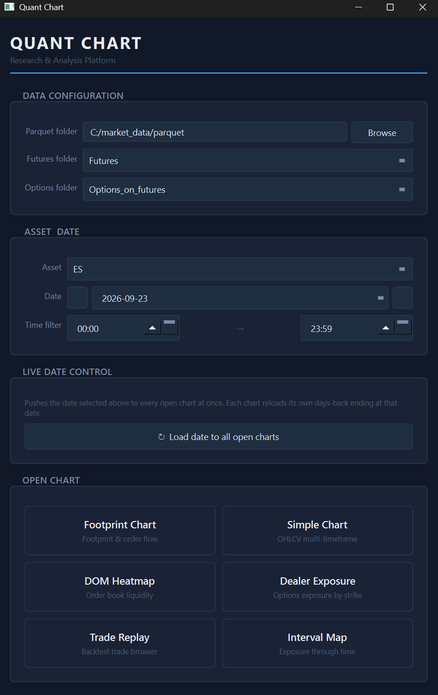
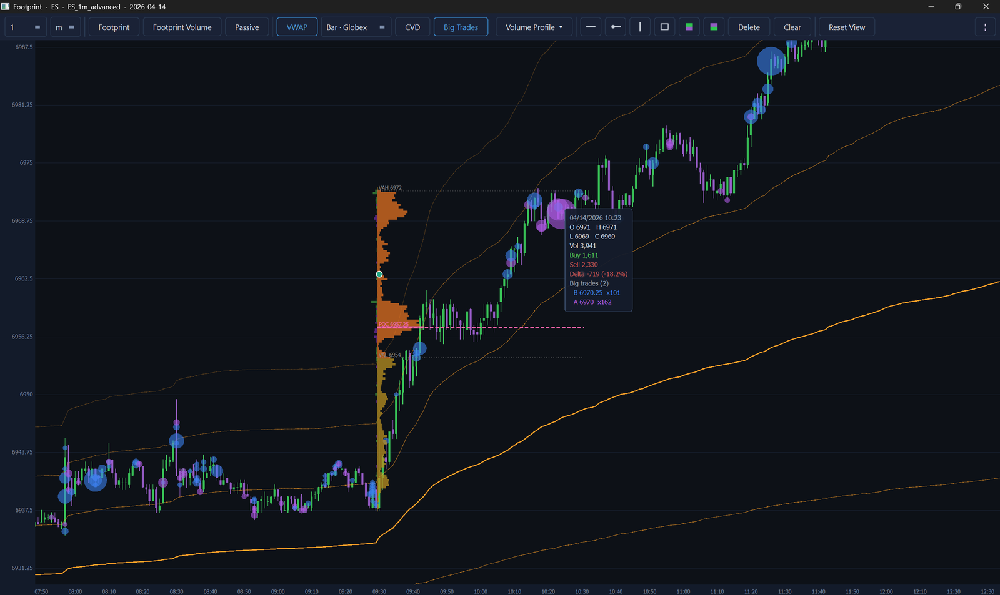
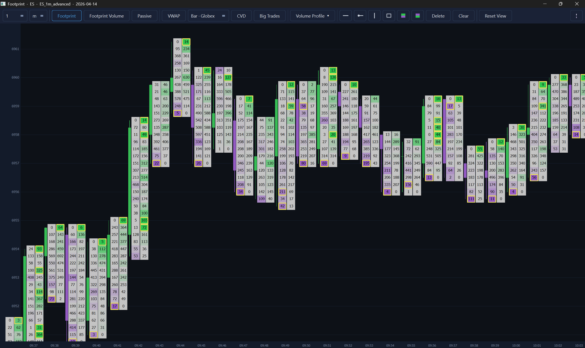
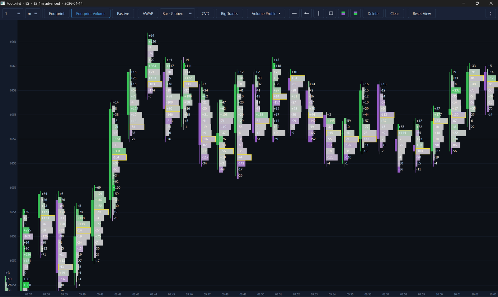
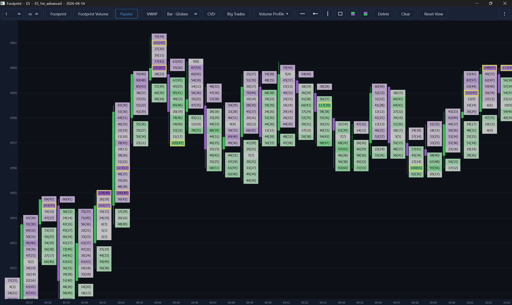
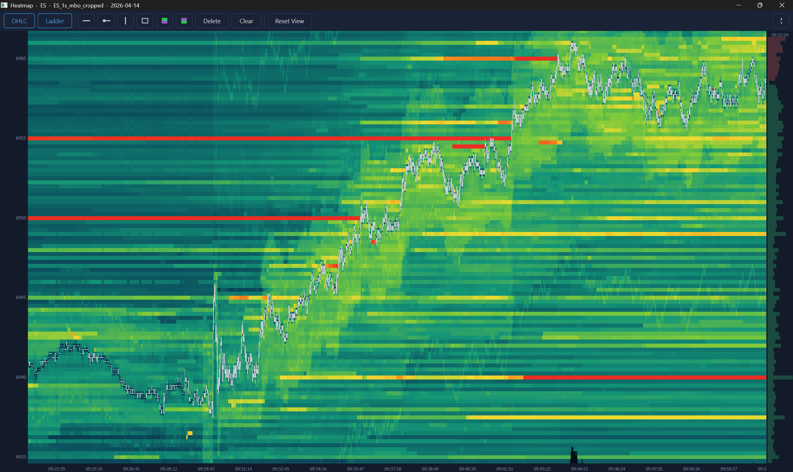
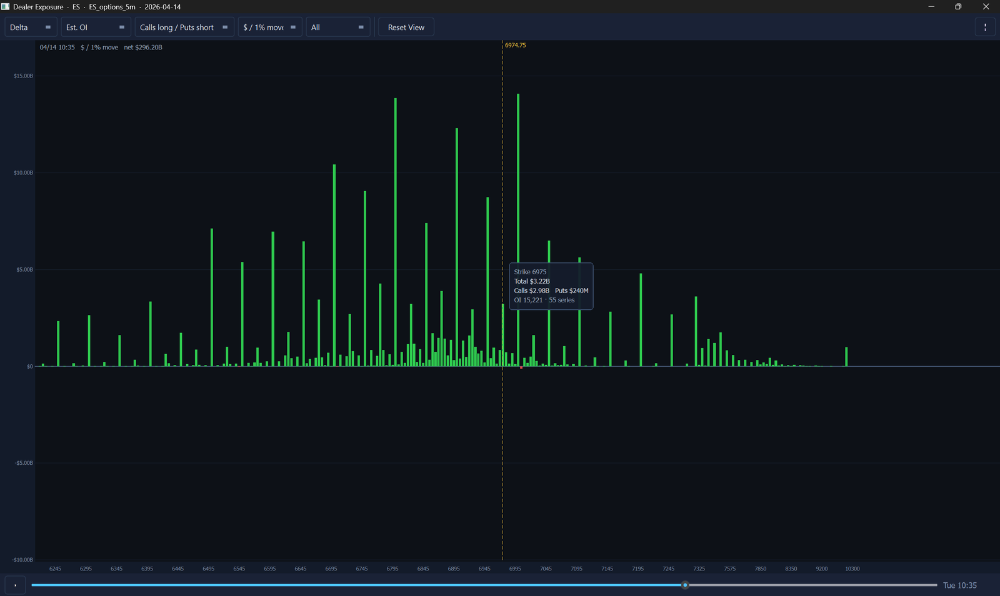
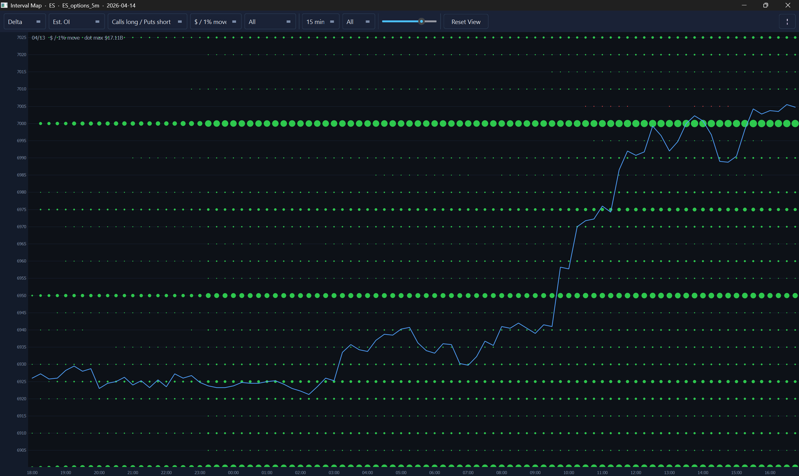
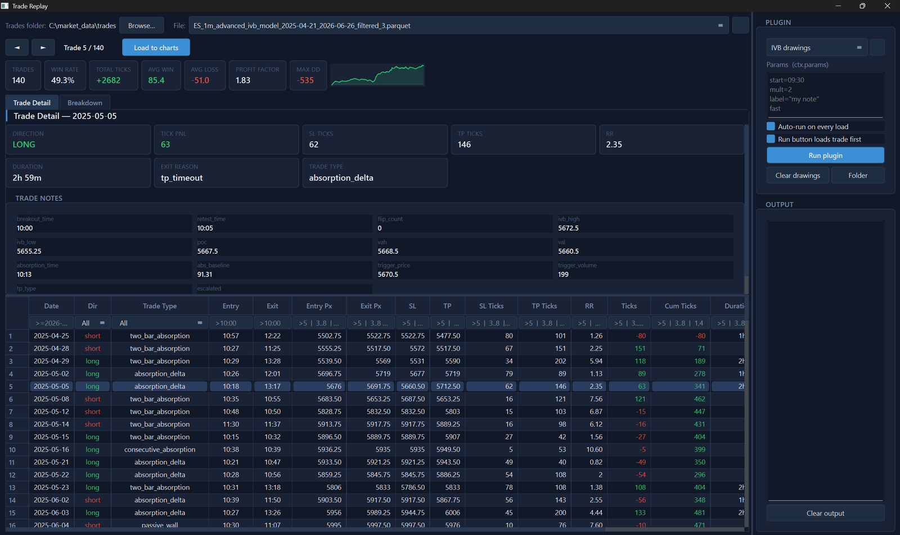
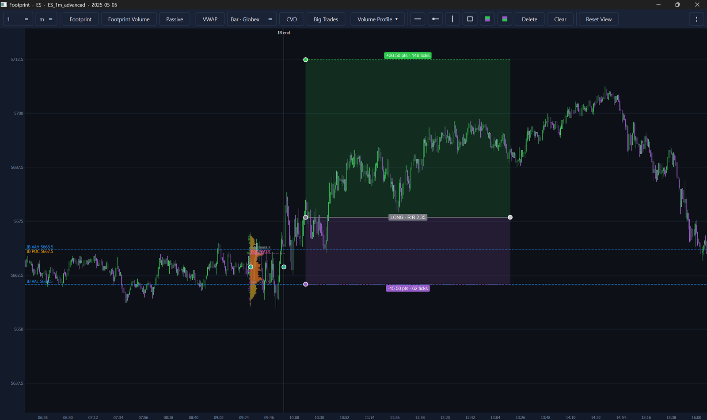

# Quant Chart

A native desktop charting tool for reading **order flow and options positioning** on intraday futures. It has five chart types (footprint, OHLCV, order-book heatmap, dealer options exposure and an intraday exposure map) plus a trade-replay browser that pushes backtest trades onto every open chart.

Built in Python with PyQt6 (custom QPainter rendering), NumPy and pandas, reading Parquet data on disk. No server, no web layer.

<p align="center">
  
</p>

The home window picks the data folders, asset and date, and opens any chart. **Live date control** pushes a new date to every open chart at once, and each chart reloads its own data for that day.

---

## Footprint chart

Enriched 1-minute candles with everything needed to read order flow. Every layer can be toggled from the toolbar, and the timeframe can be changed without losing drawings.

### Overview: volume profile, VWAP and large trades



- **Volume profiles** (manual, per-session ETH/RTH and multi-day composite) built with a peak-based algorithm: it smooths per-price volume, finds clustered peaks and expands each to a 70% value area, so POC/VAH/VAL stay meaningful even on bimodal days
- **Anchored VWAPs** with standard-deviation bands
- **Large-trade bubbles** sized by contracts, coloured by aggressor side (buyer or seller), with separate size filters for regular and extended hours
- Hover tooltip with OHLC, volume, buy/sell split, delta and the large trades inside the candle

### Aggressive orders



Market orders traded at every price inside each candle: **sell-side aggressors on the left, buy-side on the right**. Cells where one side outweighs the other past a set ratio are outlined as **imbalances**.

### Aggressive volume and delta



The same candles as per-price **volume bars**: length is total volume, colour shows the buy/sell balance, the number is the **delta** at that price, and the highest-volume price of each candle (its POC) is outlined.

### Passive orders



The **resting limit orders** sitting at each price at the moment price first traded there: resting size, with the number of orders in brackets. Above the candle's open these are **passive sell orders** (offers), below it **passive buy orders** (bids). Unusually large resting size is outlined.

Drawing tools on all time-based charts: horizontal lines, rays, vertical lines, boxes and long/short position tools. Drawings are anchored to timestamps, so they stay in place across timeframe and date changes.

---

## OHLCV chart

A plain candlestick chart with a VWAP overlay and the same drawing tools, for instruments that only have standard OHLCV data.

---

## Order-book (DOM) heatmap



Resting bid/ask depth from **1-second MBO (L3) data**, drawn as a colour grid over time. Bright horizontal lines are large resting orders, and you can see them being pulled or traded through.

- A multi-resolution pyramid keeps rendering fast at every zoom level, never sampling finer than the screen can show
- Price overlay as OHLC bars per time bucket, and a right-edge **quantity ladder** for the rightmost visible second
- Tooltip with best bid/ask and resting size at the hovered price

---

## Dealer options exposure



Exposure by strike for **options on futures** (here ES options), with a dashed line at the underlying futures price:

- **Black-76** Delta, Gamma, Vanna and Charm exposure per strike, plus raw open-interest views, in $ per 1% move or contracts
- **Implied volatility** solved per contract with a vectorized, bracketed Newton method (bisection fallback, no-arbitrage checks), then interpolated across strikes for each expiry. Pure NumPy, no SciPy
- Position source: open interest, estimated OI or dealer flow, with a selectable dealer-positioning assumption and expiry filters (0DTE, this week, this month, …)
- A **time slider** over the full Globex session in 5-minute steps, with autoplay
- Tooltip per strike: total, call and put exposure, open interest and number of option series

---

## Interval map



The same exposure engine unrolled over the whole session: time on the x-axis, strikes on the y-axis, one dot per (time, strike) cell with **area proportional to exposure**, and the underlying price drawn on top in blue. It shows where exposure concentrates and how price moves around those strikes during the day.

---

## Trade replay



A browser for backtest trades, for example from my [Quant Research Platform](https://github.com/Jakub-Borto/Quant-app):

- Summary cards (win rate, total ticks, profit factor, max drawdown) and an equity sparkline
- Per-trade detail including the strategy's own notes (levels, signal times, trigger values)
- Filterable, sortable trade table with a small filter language in the header row (`>5`, `3..8`, `>=10:00`)
- **Plugin scripts** that receive the selected trade and the open charts, with free-form parameters; plugins are re-imported fresh on every run, so they can be edited without restarting



**Load to charts** sends the selected trade to every open chart: all charts jump to the trade's date, and footprint/OHLCV charts draw the position (entry, stop, target and risk/reward) in place. Here a plugin has also drawn the strategy's levels: the opening-range volume profile with its POC and value area, and the end of the opening range.

---

## How it is built

- **Shared core:** every chart uses the same `Viewport` (pan, zoom and pixel↔price↔time mapping) and the same drawing tools
- **One-way data flow:** loaders turn a selection into immutable in-memory models; canvases only read them, and nothing ever writes back to the data files
- **Live settings:** visual settings are dataclasses persisted with `QSettings` and read on every paint, so most changes apply instantly without reloading data

```
Quant_chart/
├─ main.py            entry point
├─ core/              shared: viewport, drawing anchors, timeframes, data paths, theme
└─ views/
   ├─ menu/           home window
   ├─ footprint_chart/
   ├─ ohlcv_chart/
   ├─ heatmap_chart/
   ├─ options_chart/  incl. black76.py (Greeks + implied-vol solver)
   ├─ interval_map/
   └─ trade_replay/   incl. plugins/
```

---

## Getting started

```bash
python -m venv venv
venv\Scripts\activate        # Windows
pip install -r requirements.txt
python main.py
```

Data is read from daily Parquet files (one file per trading day, tz-aware `America/New_York` index, full Globex session):

```
<root>/{type}/{asset}/{dataset}/YYYY-MM-DD.parquet
   e.g. Futures/ES/ES_1m_advanced/2025-04-30.parquet
```

| Dataset | Used by |
|---|---|
| 1-minute order-flow bars (per-price aggressive volume, passive orders) + indicators + large trades | Footprint chart |
| Standard 1-minute OHLCV | OHLCV chart, underlying price for options |
| 1-second MBO book snapshots | DOM heatmap |
| 5-minute options data with open interest | Dealer exposure, interval map |
| Backtest trades | Trade replay |

The datasets are produced by my [Quant Research Platform](https://github.com/Jakub-Borto/Quant-app) from Databento market data, which is not included in this repository.

---

## Documentation

- [`Quant_chart_documentation.pdf`](docs/Quant_chart_documentation.pdf): project structure and code reference (written for the first version, which had the footprint chart only)

---

*Personal research project by [Jakub Borto](https://github.com/Jakub-Borto), CS&E student at TU Delft. Nothing here is investment advice.*
